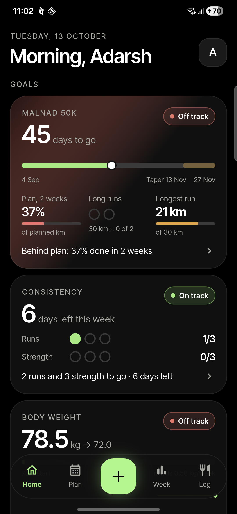
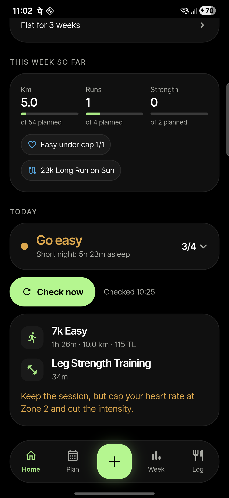
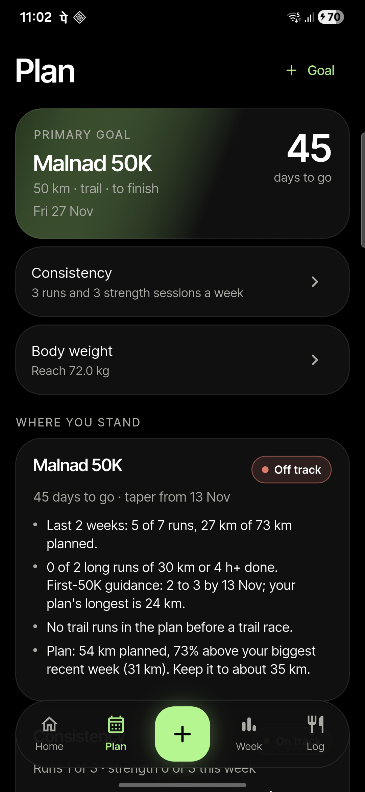
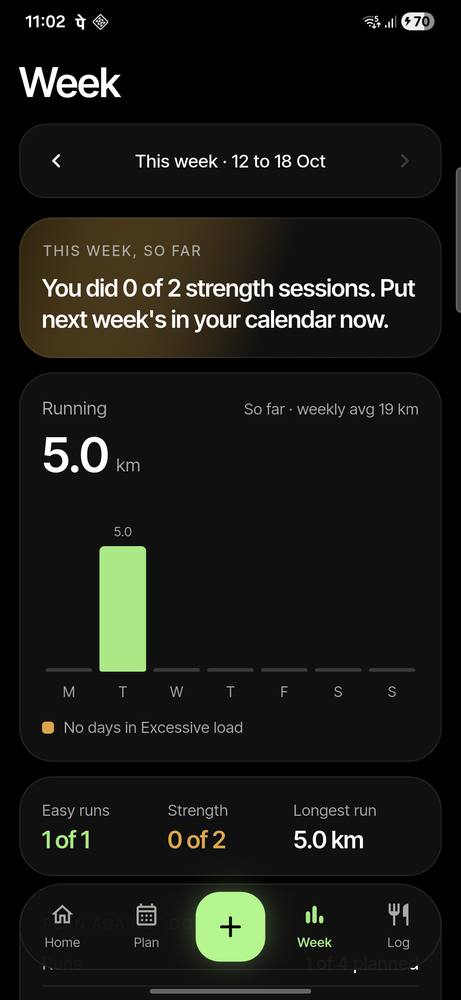
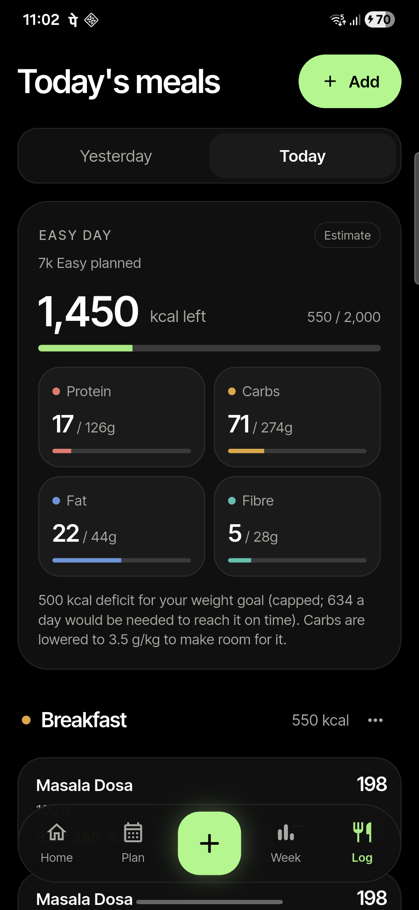
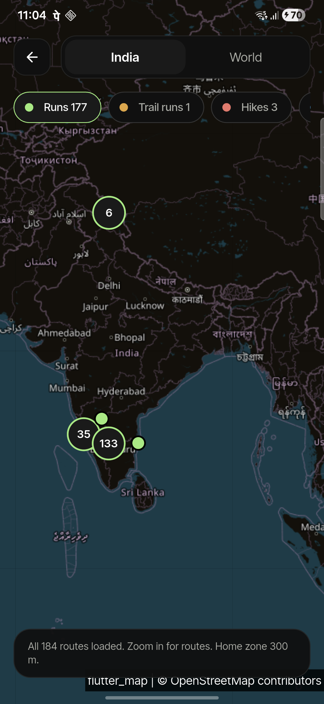
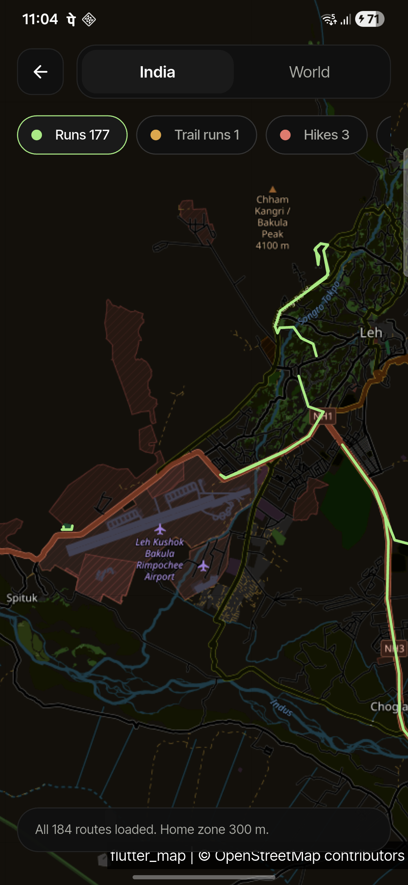
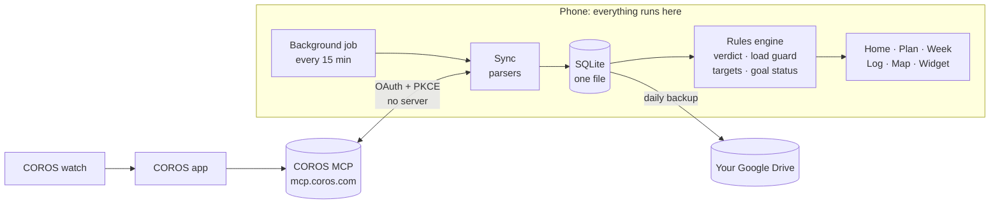

# Training Companion

**A personal Android app that turns COROS watch data into decisions: what to do today, whether the training plan is safe, how the week went, and whether I'm on track for my goals.**

Built by one product manager, with Claude Code, on top of the official COROS MCP server. Flutter, on-device, no backend.

> **Status:** in daily use by its one user (me), October 2026. Six milestones shipped in six days. 156 automated tests, mostly on real data.

---

## Why I built it

1. **To learn the tools of the trade by doing.** I'm a product manager moving into AI products. Writing a PRD is one thing; shipping against it with an AI coding agent, on a real device, every day, is another.
2. **To find out what the COROS MCP makes possible.** COROS opened its data to AI assistants through MCP (Model Context Protocol). I wanted to see whether the same connection could power a real app, not just a chat.
3. **To solve a real problem: mine.** I'm training for my first 50 km trail ultra, and my own data showed I was training badly.

## The problem

A 12-week review of my COROS data (July to September 2026) showed five problems:

| Problem | Evidence |
| --- | --- |
| **Load spikes** | Two long runs a week apart pushed the load ratio to 2.11: four days flagged Excessive |
| **Easy runs run too hard** | 7 of 18 runs on my home loop averaged 155+ bpm, one three days after a half marathon |
| **Strength fades as mileage rises** | About 2 sessions a week in July, then 0 or 1 a week from August |
| **No steady base** | Weekly volume swung between 5 and 34 km |
| **No food or weight data** | The watch records neither, so diet and body goals can't be tracked |

COROS already shows most of these numbers. **What was missing was judgement:** a call on what to do today, a guard that stops a plan from repeating those mistakes, and a weekly check against a goal.

## Who it's for

**One user: me.** A deliberate choice (see [decisions](#key-product-decisions)).

- Early 30s, city-based, runs 3 to 4 times a week, half marathons so far
- Training for the **Malnad 50K trail ultra (27 Nov 2026)**, following a plan built in the COROS app
- Strength training that slips when life gets busy; travels often, including to altitude

**Jobs to be done**

- *When I wake up,* tell me whether to train as planned, go easy or rest, and why, in one glance.
- *When I look at my plan,* warn me if it repeats my mistakes (too much too soon, no recovery weeks, no taper).
- *On Sunday,* tell me how the week went against the plan, and the one thing to change.
- *Every day,* tell me what to eat for the training I'm doing, and whether my weight is moving.
- *Always,* show me where I stand against my goals.

## Product principles

1. **Rules, not AI, for the decisions.** Every verdict comes from fixed, readable rules with the numbers that triggered it. I need to trust a call about my body; a black box doesn't earn that.
2. **COROS is the source of truth.** The app adds judgement, not another place to enter workouts.
3. **On the device, no backend.** Health data stays on the phone and in my own Google Drive. Nothing to host, nothing to breach.
4. **Honest data.** "Coros said nothing" and "Coros changed its format" are different things, and the app never mixes them up. Estimates are labelled as estimates.
5. **Visual first, detail on demand.** The first screen is glanceable; the reasons live one tap away.

## What it does

| Area | What you get |
| --- | --- |
| **Home** | Each goal drawn, not described: the race countdown and block timeline, plan adherence, long-run progress, weight against target, the week so far, and insights that apply today |
| **Morning check** | Go as planned, Go easy or Rest, from HRV, resting heart rate, sleep and training load, with each signal against its normal range. Runs automatically after waking and notifies |
| **Plan guard** | Checks the COROS plan week by week against load rules: volume growth, long-run growth, recovery weeks, back-to-back hard days, taper, gaps before race day. Plus a sourced long-run benchmark for a first 50K |
| **Weekly review** | Planned against done, easy runs under the heart-rate cap, load, aerobic fitness (pace at a fixed heart rate), recovery, body and food, and one thing to change |
| **Food and body log** | Day-type targets (rest, easy, hard) from resting energy plus COROS active calories; Indian foods (IFCT 2017), cooked dishes with household portions (USDA), packaged foods, a recipe builder, and weight trend |
| **Run map** | Every outdoor activity since 2025 on a dark map: clustered pins, then route lines from GPS files, with a home privacy zone |
| **Widget and notifications** | The verdict on the home screen; a Sunday summary |

### Screenshots

Real data from my phone, 13 October 2026: 45 days before the race, behind plan, and a short night.

| Home: goals | Home: this week and today | Plan: where you stand |
| :---: | :---: | :---: |
|  |  |  |
| **Week: review** | **Log: food and targets** | **Run map** |
|  |  |  |

<p align="center"><br><sub>Zoomed in, pins become routes drawn from each run's GPS file (Leh, at altitude).</sub></p>

## How it works



- **No backend.** The phone signs in to COROS directly, using the same pattern as COROS's own command-line client: dynamic client registration, PKCE, and a local loopback redirect. No secret, no relay server.
- **COROS answers in prose.** The MCP returns human-readable reports written for AI assistants, not JSON. The app parses them with strict parsers tested against 22 saved real replies, stores the raw text next to the parsed values, and treats an unreadable reply as an error, never as "no data".
- **Background work** runs as Android WorkManager jobs, because since Android 15 a backgrounded app has no network access otherwise.

The plain-language version: **[docs/HOW-IT-WORKS.md](docs/HOW-IT-WORKS.md)**. The full spec: **[PRD.md](PRD.md)**.

## Success measures

The app succeeds if I keep using it and the problems in the baseline improve over a full training block.

| Metric | Baseline (Jul to Sep 2026) | Target |
| --- | --- | --- |
| Days the morning check is viewed | Not tracked | 5+ of 7, for 4 straight weeks |
| Verdict matches my own judgement | n/a | 4 of 5 days |
| Easy runs at or under the heart-rate cap | Not measured (no cap set); 7 of 18 home-loop runs averaged 155+ bpm | 80%+ |
| Strength sessions a week | 1.2 average | 2 a week, in 3 of every 4 weeks |
| Days in COROS "Excessive" load | 4 of the last 31 | 0 outside race week |
| Weekly volume change | Swung 5 to 34 km | Within load-guard limits every week |
| Pace at a fixed easy heart rate | About 8:15 to 7:52 /km since July | Faster over 8 to 12 weeks |
| Days with meals and weight logged | None | 5+ of 7 |

**Guardrail metric:** zero silent failures. Every failed sync, unreadable reply or slow screen is written to an on-device error log.

## Key product decisions

| Decision | Why | Trade-off accepted |
| --- | --- | --- |
| **One user, no store listing** | The value is in fitting one person's data and rules exactly; it also keeps the privacy story simple | No growth story; this is a learning and portfolio project |
| **Fixed rules over AI judgement** | Explainable, testable against history, trustworthy for health calls | Less nuance than a coach; rules need tuning |
| **Guard the existing COROS plan instead of building one** | COROS only lets apps edit plans they created; my plan lives in the COROS app. Guarding it shipped in a day | Advice ("change this in COROS") rather than one-tap fixes. A rule-built planner is planned for after the race |
| **Benchmarks, sourced and labelled** | The 50K long-run benchmark comes from published plans, not invented numbers | Generic guidance; shown as such, not as a verdict on my plan |
| **Calories win on weight-loss days** | The default carb rules left no room for a deficit on easy days | Easy-day carbs drop to 3 g/kg; hard days stay fully fuelled |
| **Estimates from USDA when I don't know the numbers** | Manual entries were guesses that didn't add up (600 g of carbs in 600 kcal) | US recipes and portions; labelled a rough guide |
| **Visual Home, details on Plan** | My first version of Home was accurate but too wordy to glance at | Two places to look; one tap between them |

## What I learned

Fifty-five findings are logged in **[learnings.md](learnings.md)**. The ones worth knowing:

- **An AI-facing API is not an app-facing API.** COROS MCP replies are prose for language models: wording can change silently, a rest day is "No training schedule found.", and a plan's workouts arrive as codes like `S5715` until you resolve them. Strict parsers plus real saved replies as test fixtures caught every change.
- **The platform is part of the product.** Android 15 blocks background network for apps that aren't in front, Samsung freezes cached apps, and COROS's "50 files a day" turned out to be a rolling 24 hours. None of this shows up in a spec; all of it showed up on the phone.
- **The hardest bug was architectural.** Endless loading came from the background job and the screens using separate database connections on a library that runs everything on one thread. Diagnosis took logs from the device and a reading of the library's source.
- **Reference data needs checking too.** The Indian Food Composition Tables list cooking oils and ghee at 0 kcal; every recipe using them was undercounted until the data was corrected.
- **Free services change.** CARTO's free map tiles started requiring a key mid-build; the app now falls back to darkened OpenStreetMap tiles.
- **Feedback loops beat specs.** Every milestone ended with me using the app and reading its logs, which surfaced most of the real issues: wordy screens, confusing advice, a stuck notification.

## How it was built

I worked as the product manager; Claude Code wrote the code.

- **A PRD as the contract.** Problem, persona, rules, success metrics and milestones were written first, then updated as decisions changed (sole user, follow the COROS plan, calories win).
- **Milestone by milestone.** Each milestone was built, tested on my phone, reported, and approved before the next began.

  | Milestone | Shipped |
  | --- | --- |
  | M0: Spike (COROS sign-in from a phone, read and write, widget) | 2 Oct 2026 |
  | M1: Morning check | 2 to 3 Oct |
  | M2: Weekly review | 3 Oct |
  | M3: Goals and plan guard | 5 Oct |
  | M4: Food and body log | 5 Oct |
  | M5: Run map | 7 Oct |
  | Home redesign, reliability fixes | 7 to 13 Oct |
  | Planner that pushes workouts to the watch | After the race |
- **Real data as test fixtures.** COROS replies, a FIT file and food data are saved and replayed in tests, so a parser change is caught before it reaches the phone.
- **A learnings log** (`learnings.md`) recording each finding, its fix, and what changed in the PRD.

About 11,000 lines of Dart in the app, 2,000 in tests.

## Repository map

```
PRD.md                 Product requirements: problem, persona, rules, metrics, milestones, decisions
learnings.md           55 findings from building and using it, with the fix for each
docs/HOW-IT-WORKS.md   Plain-language tour of the setup
app/                   The Flutter app
  lib/coros/           COROS sign-in, MCP client, strict parsers
  lib/rules/           Verdict, load guard, weekly review, goal status, insights
  lib/food/            Food data, targets, recipes
  lib/map/             FIT decoding, routes, privacy zone
  lib/sync/            Morning check, background job, data loading
  lib/ui/              Screens
  test/                156 tests; test/fixtures holds real replies (privacy-edited)
spike/                 Node scripts from the M0 sign-in spike, and its findings
```

## Run it yourself

It's built for one person's COROS account, but it runs for anyone with one.

1. Install **Flutter 3.47** and **Android Studio** (SDK, platform tools, NDK 28.2.13676358).
2. Optional, for Drive backup: create a Google Cloud project with an OAuth Web client and an Android client for your signing key, then copy `app/dart_defines.example.json` to `app/dart_defines.json` and add your Web client ID.
3. Build and install:

```bash
cd app
flutter test
flutter build apk --debug --target-platform android-arm64 --dart-define-from-file=dart_defines.json
adb install -r build/app/outputs/flutter-apk/app-debug.apk
```

4. Open the app and connect your COROS account. Sign-in happens on the phone; there's nothing to host.

## Data sources and credits

- **COROS MCP** for watch data, under COROS's self-service terms for single-user apps. This project isn't affiliated with or endorsed by COROS.
- **Indian Food Composition Tables 2017** (National Institute of Nutrition, Hyderabad), via the MIT-licensed `@ifct2017/compositions` package; energy for oils recomputed from macros.
- **USDA FoodData Central, FNDDS** (public domain).
- **Open Food Facts** (Open Database License).
- **OpenStreetMap** contributors and **CARTO** for map tiles.
- **Inter Tight** font (SIL Open Font License).
- The visual style was inspired by a dark nutrition-tracker concept; the reference images aren't included.

## Privacy

Everything stays on the phone and in the user's own Google Drive app folder. COROS tokens live in Android Keystore and never leave it. The test fixtures are my real data with privacy edits: GPS positions moved, the birth date changed, and the COROS user ID removed.

## Disclaimer

Training and nutrition guidance from fixed rules and published sources, for one person. Not medical or dietetic advice.

## License

[MIT](LICENSE)
